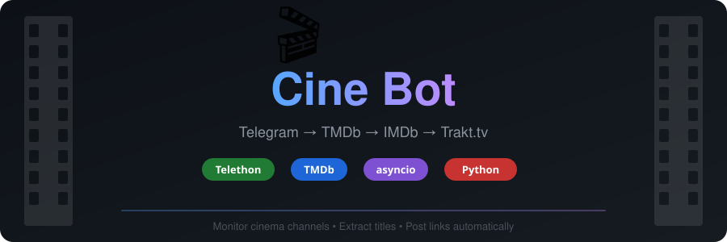

<p align="center">
  
</p>

<p align="center">
  
  
  
  
</p>

<p align="center">
  Telegram-бот, который мониторит публичные каналы о кино, извлекает названия фильмов и сериалов,<br/>
  ищет их в TMDb и публикует в целевой канал сообщения со ссылками на TMDb, IMDb и Trakt.tv.
</p>

---

## Как это работает

1. **Userbot** (Telethon, user API) слушает новые посты в source-каналах
2. Из текста поста извлекаются названия — по кавычкам (`«»`, `""`, `„"`) или bold-разметке
3. Каждое название ищется в **TMDb** (сначала фильмы, потом сериалы)
4. **Bot** (Telethon, bot token) отправляет в целевой канал отформатированное сообщение:

```
💬 ┃ Текст оригинального поста из канала-источника...

🎬 The Brutalist (2024)
📌 TMDb | IMDb | Trakt.tv
```

## Структура проекта

```
config.py        — загрузка конфигурации из .env
extractor.py     — извлечение названий из текста/entities
tmdb_client.py   — поиск по TMDb API, получение imdb_id, формирование ссылок
formatter.py     — форматирование HTML-сообщения
main.py          — точка входа, запуск обоих клиентов
```

## Установка

```bash
git clone https://github.com/nlkolay/cine-bot.git
cd cine-bot
pip install -r requirements.txt
cp .env.example .env
```

## Настройка

Заполните `.env` файл:

| Переменная | Где получить |
|---|---|
| `API_ID`, `API_HASH` | [my.telegram.org](https://my.telegram.org) → API development tools |
| `BOT_TOKEN` | [@BotFather](https://t.me/BotFather) → `/newbot` |
| `TMDB_API_KEY` | [themoviedb.org/settings/api](https://www.themoviedb.org/settings/api) → Create → Developer |
| `TARGET_CHANNEL` | Username (без `@`) или числовой ID канала, куда постить |
| `SOURCE_CHANNELS` | Каналы через запятую (без `@`), откуда читать |

Бот должен быть добавлен **администратором** в целевой канал.

## Запуск

```bash
python main.py
```

При первом запуске Telethon запросит код авторизации из Telegram для userbot-сессии.

## Зависимости

- [Telethon](https://github.com/LonamiWebs/Telethon) — Telegram MTProto клиент
- [aiohttp](https://github.com/aio-libs/aiohttp) — HTTP-запросы к TMDb API
- [python-dotenv](https://github.com/theskumar/python-dotenv) — загрузка `.env`
